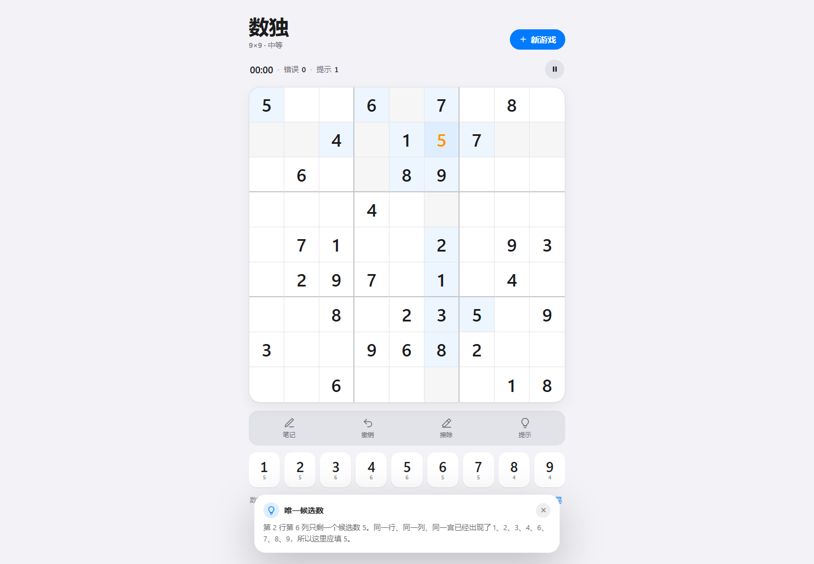

# 数独 · Sudoku

一个完全离线、可以安装到桌面 / 主屏幕的数独游戏。支持 **4×4**、**6×6**、**9×9** 三种棋盘，以及 **简单 / 中等 / 困难** 三种难度。

> 🌐 **在线试玩 / 安装**：<https://carloswuwu.github.io/sudoku/>


## 开始游戏

任选一种方式：

1. **打开在线版** <https://carloswuwu.github.io/sudoku/>，无需安装，手机 / 平板 / 电脑浏览器都能直接玩。
2. **安装成 App**（推荐）：在 Chrome / Edge 中打开上面的网址，点击地址栏右侧的「安装」图标，或菜单 →「安装 数独」；iPhone / iPad 用 Safari 打开后点「分享」→「添加到主屏幕」；Android Chrome 菜单 →「安装应用」。安装后是一个独立的全屏应用窗口，即使离线也能玩。
3. **双击桌面上的「数独」快捷方式**（Windows，本机版本）。
4. 双击本文件夹里的 `play-sudoku.bat`。
5. 直接双击 `index.html`，用任意浏览器打开。

在线版首次打开后会把游戏缓存到本地（Service Worker），之后断网也能继续玩；进度保存在浏览器本地，关闭后再打开会接着玩。

## 怎么玩

- 点击棋盘上的空格选中它，然后按键盘数字键，或点击下方的数字键盘填入数字。
- 每一行、每一列、每一个粗线围成的宫格里，数字 1–N 都要恰好出现一次：
  - 4×4：每宫 2×2
  - 6×6：每宫 2 行 × 3 列
  - 9×9：每宫 3×3
- 填入的数字如果与**同行、同列或同宫**已有的数字重复，会标红并累计「错误」次数（所有发生冲突的格子都会标红，不影响继续游戏）。
- 没有冲突的数字不会被提示对错，需要自己推理；只有整盘填满且没有任何冲突才算完成。
- 点击「新游戏」可以随时切换棋盘尺寸和难度。
- 倒计时可以暂停；完成整盘后会显示成绩单。

## 快捷键

| 按键 | 功能 |
| --- | --- |
| 数字键 `1` – `9` | 填入数字（按当前棋盘尺寸取有效数字） |
| `Backspace` / `Delete` | 擦除当前格 |
| `↑` `↓` `←` `→` | 移动选中的格子 |
| `N` | 切换笔记（候选数）模式 |
| `Ctrl` + `Z` | 撤销 |
| `H` | 提示（基于逻辑推理，并解释原因） |
| `P` | 暂停 / 继续 |
| `Esc` | 暂停时继续 / 关闭弹窗 |

## 逻辑提示

点击「提示」或按 `H` 时，游戏不会直接翻看答案，而是根据当前盘面推理出一个可以确定的数字，并弹出说明卡片，解释这个数字为什么成立；同时高亮相关的行 / 列 / 宫，目标格会播放圆环和数字弹入动画。

提示会按从易到难的顺序尝试以下技巧：

- **唯一候选数**：某个格子的候选数只剩一个。
- **行内唯一 / 列内唯一 / 宫内唯一**：某个数字在一行 / 一列 / 一宫中只有一个位置可以放。
- **数对排除**：两个格子的候选数完全相同，排除其他格子的这两个候选数后得到唯一解。
- **反证法**：逐个尝试候选数，只有能让盘面继续完成的那个才成立。

如果盘面存在冲突，或者填入的数字和题目的唯一解不一致，提示会提醒先检查已填的数字，而不会给出不可靠的答案。提示卡可以手动关闭，也会在几秒后自动消失。



## 功能特点

- 简洁的 Apple 风格界面，自动跟随系统浅色 / 深色模式，手机、平板、电脑都适配。
- **PWA 支持**：可安装到桌面 / 主屏幕，独立窗口运行，并支持离线游玩。
- 三种棋盘尺寸 × 三种难度，全部由程序随机生成，**保证每道题只有唯一解**。
- **逻辑提示**：每一步都说明推理依据，配合高亮和动画，而不是简单公布答案。
- 笔记、撤销（最多 200 步）、擦除、提示、暂停、计时、错误计数。
- 高亮当前行 / 列 / 宫，以及相同数字，方便推理。
- 自动保存 / 恢复进度，自动记住上次的棋盘尺寸与难度。
- 无第三方依赖、无网络请求（在线版仅首次加载需要网络）。

## 安装为 App（PWA）说明

游戏包含 `manifest.webmanifest`、Service Worker 和完整尺寸的应用图标，满足浏览器安装条件：

- **Chrome / Edge（桌面）**：打开在线版 → 地址栏右侧出现安装图标；或菜单 →「安装 数独」。也可以使用游戏底部的「安装 App」按钮（支持 `beforeinstallprompt` 的浏览器才会出现）。
- **iPhone / iPad（Safari）**：打开在线版 →「分享」→「添加到主屏幕」。
- **Android（Chrome）**：打开在线版 → 菜单 →「安装应用」/「添加到主屏幕」。
- 安装后以 `standalone` 模式运行，没有浏览器地址栏；Service Worker 会缓存游戏资源，断网也能玩。

> 提示：Service Worker 需要 HTTPS 或 localhost，因此在线版（GitHub Pages 提供 HTTPS）支持离线；直接双击 `index.html` 的本地文件模式不支持 Service Worker，但本身不需要联网。

## 文件说明

| 文件 | 说明 |
| --- | --- |
| `index.html` | 页面结构 |
| `style.css` | 界面样式 |
| `sudoku-core.js` | 数独出题、求解与唯一解校验（纯逻辑） |
| `sudoku-hints.js` | 逻辑提示引擎（唯一候选、行列宫唯一、数对排除、反证法） |
| `app.js` | 界面交互逻辑、提示动画与 PWA 安装提示 |
| `manifest.webmanifest` | PWA 应用清单 |
| `sw.js` | Service Worker（离线缓存） |
| `icon-192.png` / `icon-512.png` | PWA 图标（512 也用于 maskable） |
| `apple-touch-icon.png` | iOS 主屏幕图标 |
| `icon.ico` | Windows 桌面快捷方式图标 |
| `play-sudoku.bat` | Windows 启动器（应用窗口模式） |
| `screenshot.png` | 游戏截图 |
| `hint-screenshot.png` | 逻辑提示截图 |
| `tests/` | 开发测试（普通玩家不需要） |

## 开发与测试

核心逻辑测试（无需安装依赖）：

```bash
node tests/core.test.js
node tests/hints.test.js
```

界面逻辑测试与真实浏览器检查（需要先安装测试依赖，并确保本机有 Edge）：

```bash
npm install --prefix tests
node tests/ui.test.js
node tests/browser-qa.js
node tests/pwa-qa.js
```

- `tests/hints.test.js` 覆盖唯一候选、行/列/宫唯一、数对排除、反证法，并验证从空盘只用提示即可完成三种尺寸 × 三种难度。
- `tests/browser-qa.js` 用无头 Edge 打开游戏、模拟点击操作，并输出桌面 / 平板 / 手机 / 深色模式截图。
- `tests/pwa-qa.js` 针对已部署的在线版检查 PWA 清单、Service Worker、安装条件，并模拟断网重新加载验证离线可用。默认检查 <https://carloswuwu.github.io/sudoku/>，可通过环境变量 `PWA_URL` 指定其他地址。
