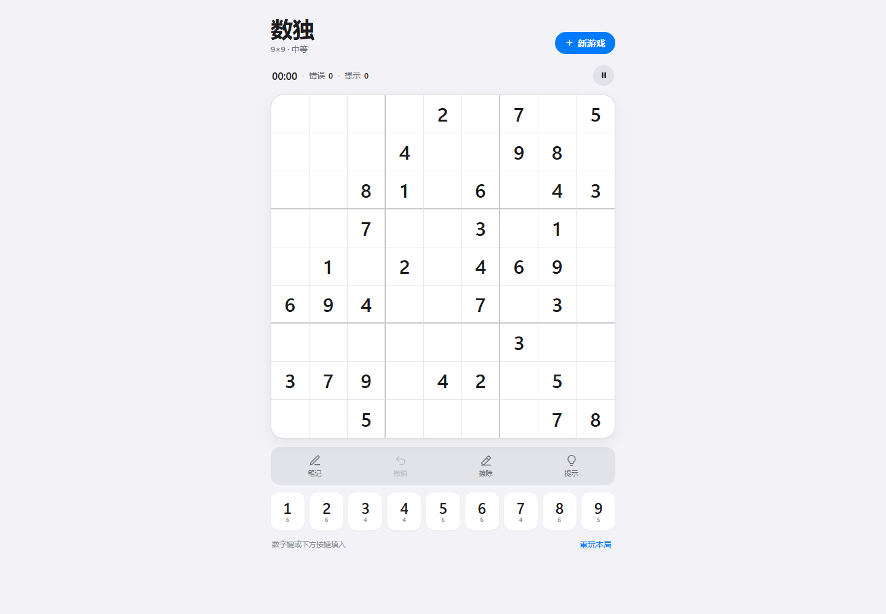

# 数独 · Sudoku

一个完全离线、可以直接在电脑桌面上玩的数独游戏。支持 **4×4**、**6×6**、**9×9** 三种棋盘，以及 **简单 / 中等 / 困难** 三种难度。

> 🌐 **在线试玩**：<https://carloswuwu.github.io/sudoku/>



## 开始游戏

任选一种方式：

1. **打开在线版** <https://carloswuwu.github.io/sudoku/>，无需安装，手机/平板/电脑浏览器都能直接玩。
2. **双击桌面上的「数独」快捷方式**（会以 Edge/Chrome 应用窗口打开，像桌面软件一样）。
3. 双击本文件夹里的 `play-sudoku.bat`。
4. 直接双击 `index.html`，用任意浏览器打开。

游戏不需要联网、不需要安装任何东西；把整个文件夹复制到别的电脑上也能直接玩。

## 怎么玩

- 点击棋盘上的空格选中它，然后按键盘数字键，或点击右侧的数字键盘填入数字。
- 每一行、每一列、每一个粗线围成的宫格里，数字 1–N 都要恰好出现一次：
  - 4×4：每宫 2×2
  - 6×6：每宫 2 行 × 3 列
  - 9×9：每宫 3×3
- 填入的数字如果与**同行、同列或同宫**已有的数字重复，会标红并累计「错误」次数（所有发生冲突的格子都会标红，不影响继续游戏）。
- 没有冲突的数字不会被提示对错，需要自己推理；只有整盘填满且没有任何冲突才算完成。
- 点击「新游戏」可以随时切换棋盘尺寸和难度。
- 进度会自动保存在浏览器本地，关闭后再打开会接着玩。
- 倒计时可以暂停；完成整盘后会显示成绩单。

## 快捷键

| 按键 | 功能 |
| --- | --- |
| 数字键 `1` – `9` | 填入数字（按当前棋盘尺寸取有效数字） |
| `Backspace` / `Delete` | 擦除当前格 |
| `↑` `↓` `←` `→` | 移动选中的格子 |
| `N` | 切换笔记（候选数）模式 |
| `Ctrl` + `Z` | 撤销 |
| `H` | 提示（自动填入一个正确数字） |
| `P` | 暂停 / 继续 |
| `Esc` | 暂停时继续 / 关闭弹窗 |

## 功能特点

- 简洁的 Apple 风格界面，自动跟随系统浅色 / 深色模式，手机、平板、电脑都适配。
- 三种棋盘尺寸 × 三种难度，全部由程序随机生成，**保证每道题只有唯一解**。
- 笔记、撤销（最多 200 步）、擦除、提示、暂停、计时、错误计数。
- 高亮当前行 / 列 / 宫，以及相同数字，方便推理。
- 响应式界面：电脑、平板、手机浏览器都能玩。
- 自动保存 / 恢复进度，自动记住上次的棋盘尺寸与难度。
- 完全离线，无第三方依赖、无网络请求。

## 文件说明

| 文件 | 说明 |
| --- | --- |
| `index.html` | 页面结构 |
| `style.css` | 界面样式 |
| `sudoku-core.js` | 数独出题、求解与唯一解校验（纯逻辑） |
| `app.js` | 界面交互逻辑 |
| `icon.ico` | 桌面快捷方式图标 |
| `play-sudoku.bat` | Windows 启动器（应用窗口模式） |
| `screenshot.png` | 游戏截图 |
| `tests/` | 开发测试（普通玩家不需要） |

## 开发与测试

核心逻辑测试（无需安装依赖）：

```bash
node tests/core.test.js
```

界面逻辑测试与真实浏览器检查（需要先安装测试依赖，并确保本机有 Edge）：

```bash
npm install --prefix tests
node tests/ui.test.js
node tests/browser-qa.js
```

`tests/browser-qa.js` 会用无头 Edge 打开游戏、模拟点击操作，并把桌面/平板/手机/深色模式等尺寸的截图输出到系统临时目录。
